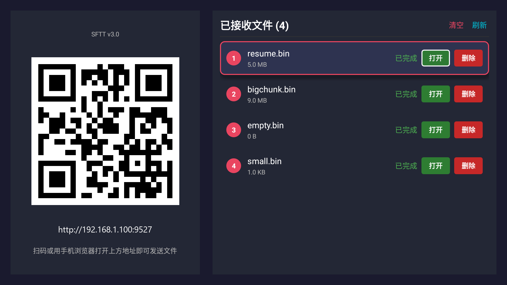
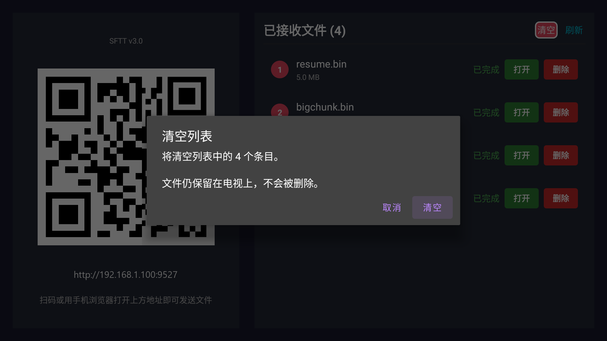

# 局域网文件传输工具（电视端 SFTT 接收）

一套**零配置、跨设备**的局域网文件传输方案：手机/电脑浏览器扫码即连电视，多线程并发发送任意格式文件，逐文件 SHA-256 校验保证完整性，并实时反馈传输进度。

整体设计**仿照 [sunshine-send](https://github.com/diduweiwu/sunshine-send)**：电视端内置 HTTP 服务器 + 二维码「扫码即传」，手机浏览器打开网页即可上传。

交付物包含两部分：

1. **Python 参考实现（已端到端验证）** —— 可直接在电脑/手机(Termux)/电视上运行，验证协议正确性。
2. **Android (Kotlin) 电视端（已编译 + 已真机实测）** —— 产出可直接安装的 APK **SFTT**。

> **Android 手机端 App 已停用**：交付形态只保留电视端 SFTT。原生手机端源码保留在 `android/phone/` 下供参考，但不再参与 Gradle 构建；备份见 `app/data/retired-phone-module.zip`。
> 上传路径改为「手机浏览器扫码 → TV 内置网页上传页」（`tv/src/main/res/raw/index.html`，支持分块、断点续传、实时进度）。

---

## 界面预览

**电视端主界面**（左侧二维码 + 右侧已接收文件列表，右上角「清空 / 刷新」）：



**「清空」确认对话框**（清空列表但**不删除**电视上的文件）：



---

## 一、核心特性

| 需求 | 实现 |
|------|------|
| 局域网自动发现，无需手动配置 | 三套并行机制：**Android NSD**、**UDP 广播信标**（电视→手机/Android/Python 通用）、**二维码**（扫一扫即传） |
| 任意格式文件 | 二进制流式读写，不限制类型/大小（支持 >2GB） |
| **不限制文件大小（50GB 级）** | 上传端**不拷贝文件**（浏览器端直接读 File 流式上传，避免撑爆手机存储）；4 MiB 大分块（50GB 仅 12800 个请求）；服务端**直写目标文件**（免二次合并，省掉一半磁盘 IO 与双倍空间） |
| **断点续传** | 稳定 fileId + 服务端落盘分块位图（`.lanpart/`）：断网重连、App 重启后仅补传缺失分片 |
| 多线程并发快速传输 | 单文件切片（TCP 通道 4MB/片、HTTP 通道 4MB/片），多片通过多条连接并行发送 |
| **最多 5 个文件同时传输** | 文件级信号量（`MAX_CONCURRENT_FILES = 5`）+ 全局分块槽位预算（`CLIENT_CHUNK_SLOTS = 8`），几百个文件自动排队 |
| 文件完整性 | 逐片 SHA-256 永远校验（覆盖每个字节）；小文件额外整文件二次复核，超大文件用「逐片+数量+总长度」判定 |
| 进度与状态反馈 | 电视端实时进度条 + 速度；网页上传页实时显示百分比；新上传文件排在最上面 |
| **一键清空列表（不删文件）** | 右上角「刷新」旁新增红色「清空」按钮 + 二次确认；只清列表条目，磁盘文件全部保留；清空状态持久（刷新/重启不复活），之后重新上传同名文件自动恢复显示 |
| **改名与图标** | 电视端桌面图标名 **SFTT**（= Send File To TV）；设备发现名统一为 **SEND FILE TO TV**；左上角版本标识 **SFTT v3.0**；图标为「电视 + 无线波纹 + 上传箭头 + 渐变底」的自适应图标（多密度 PNG + vector） |

### 应用命名与图标

| 位置 | 名称 | 说明 |
|------|------|------|
| 电视端桌面图标下方 | **SFTT** | 缩写，含义 send file to tv |
| 电视端左上角版本标识 | **SFTT v3.0** | `strings.xml` → `tv_version_label` |
| **局域网内看到的设备名** | **SEND FILE TO TV** | NSD 服务名 + UDP 广播 `name` 字段统一；设备型号另由 UDP `model` 字段携带，不污染显示名 |
| 图标 | 电视轮廓 + 无线广播弧 + 珊瑚红上传箭头 | 深紫蓝→珊瑚红对角渐变底；`mipmap-anydpi-v26` 自适应图标 + `mipmap-{m,h,xh,xxh,xxxh}dpi` 传统 PNG 双轨；生成器 `tools/gen_icons.py`（零第三方依赖，标准库 zlib 手写 PNG 编码器 + 4× 超采样抗锯齿） |

---

## 二、真机验证结果（Android 9 电视设备）

在真实电视设备（Android 9，IP `192.168.1.100`）上完成的端到端验证：

| 验证项 | 结果 |
|--------|------|
| **UDP 自动发现** | ✅ 手机端不填任何 IP，自动发现电视设备，16 次信标全收到 |
| **TCP 通道多文件并发** | ✅ 4 文件（12MB mp4 + 2.4MB jpg + 185KB txt + 0B 空文件）**4/4 成功**，3.8s 传完 14.5MB（3.8 MB/s） |
| **TCP 通道大规模并发** | ✅ 6 文件（含 8MB 大文件）**6/6 成功** |
| **文件完整性** | ✅ 真机落盘文件 SHA-256 与源文件**逐字节一致**（4/4 MATCH） |
| **HTTP 通道协议套件** | ✅ **22/22 全绿**（真实 Kotlin 服务端 + Python 客户端） |
| **异常拒绝** | ✅ 故意传错整文件/分片哈希 → 服务端返回 400 并拒绝落盘 |
| **电视自带遥控器** | ✅ 焦点随方向键正确移动（`btnOpen`↕`btnOpen`↔`btnDelete`↔`leftPanel`↔`btnRefresh`）；OK 键成功拉起系统 ResolverActivity 打开文件 |
| **手机网页遥控器** | ✅ 6 键全通：down/up 跨条目移动焦点、left/right 在「打开/删除」间切换、ok 触发点击打开文件、back 焦点回列表首项 |
| **「清空」列表（不删文件）** | ✅ 列表 4 条目 → 清空 → 0 条目，磁盘文件数 **146 → 146 保持不变**；再点「刷新」仍为 0；**重启 App 仍为 0**（持久生效）；之后新上传的文件正常回到列表；HTTP 协议回归 **22/22 全绿** |

### 大文件 / 断点续传 / 大量文件压测（真机实测）

由 `stress_test.py` 对真实电视端执行，**全部 PASS**：

| 压测项 | 实测结果 |
|--------|---------|
| **300MB 大文件** | ✅ 75 个 4 MiB 分片、53.6s、**5.6 MB/s**、整文件 SHA-256 **MATCH**、0 传输错误 |
| **服务端内存占用** | ✅ 传输 300MB 文件期间，服务端 RSS 从 **126.1 MB → 峰值 130.4 MB**（仅 +4MB）—— 证明「流式落盘 + 直写目标文件」确实没有把文件读进内存，与文件大小无关 |
| **断点续传（真机）** | ✅ 32MB 文件（8 片）中断在第 3 片 → 重连 `resumed=true` 且拿回位图 `[0,1,2]` → **仅补传缺失分片** → 补传后整文件哈希 **MATCH** |
| **大量文件（60 个）** | ✅ **60/60 成功**，8.6s；`/api/files` 清单**按时间倒序**，最新上传的排在最前面 |
| **源码级一致性** | ✅ JVM harness 跑**真实 Kotlin `HttpUploadServer`**，同样 22/22 全绿 |

> 电视端已通过 `adb connect 192.168.1.100:5555` 直连安装 APK 完成全部验证。
> 压测复现：`python stress_test.py --host 192.168.1.100 --port 9527 --adb 192.168.1.100:5555`

---

## 三、Python 参考实现（已验证）

### 目录结构
```
LanFileTransfer/
├── lantransfer/            # 协议与核心逻辑（纯标准库，无第三方依赖）
│   ├── protocol.py         # 常量、哈希、分块、行帧编解码
│   ├── discovery.py        # UDP 自动发现（扫描/宣告）
│   ├── transfer.py         # TCP 分块并发传输核心（含 FramedConn 缓冲）
│   └── progress.py         # 终端实时进度视图
├── tv_receiver.py          # 电视端接收程序入口
├── phone_sender.py         # 手机端发送程序入口
├── selftest.py             # 端到端自检（发现 + 传输 + 校验）
├── http_selftest.py        # HTTP 通道协议验证（--self 自检 / --host 真机联调）
├── verify_kotlin_http.sh   # 用真实 Kotlin HTTP 服务器做端到端验证
└── android/                # Android(Kotlin) 实现（见 android/README.md）
```

### 运行要求
- Python 3.8+（已在 3.13 验证）
- 零第三方依赖

### 电视端（接收）
```bash
python tv_receiver.py                         # 默认 0.0.0.0，接收目录 ./received
python tv_receiver.py --out-dir ./received --name "客厅电视"
python tv_receiver.py --host 127.0.0.1        # 仅本机环回，便于联调
```

### 手机端（发送）
```bash
python phone_sender.py file1.mp4 file2.zip     # 自动发现并选择电视
python phone_sender.py --tv-host 192.168.1.50 a.bin   # 直连指定电视
python phone_sender.py --threads 16 *.iso       # 指定并发数
```
手机端启动后会扫描同网设备并列出，交互选择目标（非交互环境自动选第一个），随后并发发送并展示进度。

### 验证结果
`python selftest.py` 已通过：
- 自动发现：UDP 扫描成功发现同网电视设备；
- 传输 + 校验：空文件 / 100B / 10MB / 33MB 四类文件经分块并发传输后，接收端 SHA-256 与源文件**逐字节一致**；
- 真实双进程联调：手机端自动发现 → 并发发送 5MB 二进制 + 24KB 文本 → 接收端文件名/大小/哈希完全一致，退出码 0。

---

## 四、协议简述

### 发现层（UDP / NSD）
- **Android NSD**：手机端用 `NsdManager` 发现 `_lanfile._tcp.` 服务，TXT 记录带 `dp`（数据端口）与 `hp`（HTTP 端口）。
- **UDP 广播**：电视端每 3 秒向 `255.255.255.255` 与各网卡定向广播地址发送信标；手机端广播 `DISCOVER` 时电视端立即单播应答。
  - 报文格式兼容两种写法：`"LFT1" + JSON` 前缀形式，或纯 JSON（含 `"magic":"LFT1"` 字段）。
  - 报文示例：`{"magic":"LFT1","t":"announce","v":1,"name":"局域网电视","device_id":"...","ip":"192.168.1.100","tcp_port":41235,"http_port":9527}`
- **二维码**：电视端屏幕显示 `http://<IP>:9527`，手机浏览器扫码即传（零安装）。

### 传输层 A：TCP（控制端口 41235 / 数据端口 41236）
- 控制连接：`HELLO -> READY -> MANIFEST -> MANIFEST_ACK`，之后电视端在该连接上推送 `PROGRESS` / `FILE_DONE` / `SESSION_DONE`。
- 数据连接：每个分块独立建连，首行 `CHUNK <json>` 后紧跟原始字节，落盘校验后回 `CHUNK_OK`。
- 关键细节：采用带缓冲的 `FramedConn`，`recv_line` 后保留换行符后的残留字节供后续二进制消费，避免 TCP 合并发送导致分块错位（这是初版踩过的核心坑）。

### 传输层 B：HTTP（电视端 9527 端口，主通道）
仿 sunshine-send 的「TV 内置 HTTP 服务器」范式，但**比 multipart 单流更强**：

| 方法 | 路径 | 说明 |
|------|------|------|
| GET | `/` | 内置 Web 上传页 |
| GET | `/api/device` / `/api/files` | 设备信息 / 文件清单（按时间倒序，最新在前） |
| GET | `/api/upload/status?session=xx` | 查询会话进度与已收分块位图 |
| POST | `/api/upload/init` | 创建/恢复会话，返回 sessionId、chunk_size、已收位图 |
| POST | `/api/upload/chunk` | 上传单个分块（裸二进制体，流式落盘） |
| POST | `/api/upload/commit` | 校验完整性 -> 落盘改名 |
| DELETE | `/api/file/delete?name=xx` | 删除文件 |

**大文件与续传的关键约定**：

| 请求头 | 作用 |
|--------|------|
| `X-Lan-Chunk-Size` | 客户端声明分块大小（默认 4 MiB），服务端据此计算偏移 |
| `X-Lan-File-Id` | 稳定逻辑文件 ID（名字+大小+修改时间派生），**断点续传的唯一凭据** |
| `X-Lan-Offset` | 分块在文件中的绝对偏移（显式声明，不依赖推算） |
| `X-Lan-Chunk-Sha256` | 该分片 SHA-256（服务端逐片校验） |

| 响应字段 | 作用 |
|----------|------|
| `received_b64` | 已收分块位图（Base64 的 Java BitSet），客户端据此只补传缺失分片 |
| `resumed` | 本次是否复用了历史会话 |
| `verified` | `whole` = 服务端独立重算整文件哈希；`chunkwise` = 逐片校验 |

每片一个独立请求，**逐片 SHA-256 永远校验**；整文件哈希在小文件（≤1GiB）由服务端独立重算复核，
超大文件改用「逐片校验 + 分块数量 + 总长度」判定（在密码学上等价），避免为了复核再全量读几十 GB。

---

## 五、Android 实现

见 `android/README.md`。三模块 Gradle 工程（`:shared` / `:tv` / `:harness`）——**手机端 `:phone` 已停用，不参与构建**。

### 编译

```bash
cd android
bash build/build.sh          # 产出电视端 Debug APK
```

| 端 | 产物 |
|----|------|
| 电视端 | `tv/build/outputs/apk/debug/tv-debug.apk` |

整理后的交付包（可直接安装）：

| 文件 | 端 | 应用名 | 版本 |
|------|----|--------|------|
| `dist/SFTT-v3.0-TV.apk` | 电视端 | **SFTT** | **v3.0** |

### 安装与使用

```bash
adb install dist/SFTT-v3.0-TV.apk
```

安装到电视后：屏幕上显示 **SFTT** 图标，打开后左侧是二维码 + 上传地址，左上角标注 **SFTT v3.0**。
用**手机浏览器**扫码（或手动输入电视上显示的 `http://<电视IP>:9527`）即可打开内置网页上传页，
支持多文件选择、分块上传、断点续传与实时进度。

### 双遥控器支持（电视自带 + 手机）

电视端同时支持**电视自带遥控器**与**手机网页遥控器**，两端行为完全一致：

| 遥控器 | 方向键（移动焦点） | 确认键（选定） | 返回键 |
|--------|--------------------|----------------|--------|
| 电视自带遥控器 | ✅ 系统原生焦点搜索 | ✅ | ✅ |
| 手机网页遥控器 | ✅ 复刻系统焦点搜索 | ✅ | ✅ |

手机网页遥控器面板位于上传页右下角（▲◀OK▶▼ + 返回），并实时显示「电视端选中：xxx」。

**实现要点（踩坑记录）**：Android 方向键的焦点搜索**不在视图树里**，而在系统输入管线层 ——
`ViewRootImpl.processKeyEvent()` 先让视图树消费按键，**消费失败之后**才调用
`performFocusNavigation()` 做几何焦点搜索。因此 App 层单纯派发 `KeyEvent` 是**无效的**
（方向键本就不被任何 View 消费），手机端必须自己复刻系统算法：
`focused.focusSearch(direction)` 找目标 + `target.requestFocus(direction, rect)` 落焦。
这两步都是 API 1 起的公开 API，兼容 minSdk 21；`focusSearch` 会经父链冒泡命中
`RecyclerView` 的重写，从而保留列表边缘自动滚动能力。确认键则必须**成对派发**
ACTION_DOWN + ACTION_UP（`View.onKeyDown` 只负责 `setPressed(true)`，
真正的点击发生在 `onKeyUp` 的 `performClickInternal()`）。

### 「清空」列表（不删文件）

右上角「刷新」**左侧**新增红色「清空」按钮，用于一次性清空列表中的全部条目，
**磁盘上的文件一个都不会被删除**。

| 环节 | 行为 |
|------|------|
| 按「清空」 | 弹出确认框（标题「清空列表」+ 条目数 +「文件仍保留在电视上，不会被删除」+ 取消/清空），焦点默认落在「清空」按钮上，遥控器直接按 OK 即可 |
| 确认后 | 列表条目清空，标题计数消失，磁盘文件数**保持不变** |
| 再点「刷新」/ 重启 App | 列表**仍为空**（清空是持久的） |
| 之后重新上传同名文件 | 该文件**自动回到列表**（不会被永久隐藏） |
| 仍在「上传中」的条目 | **保留不清**（它们尚未完成，清走后完成时又会写回记录，语义自相矛盾） |

**实现要点（踩坑记录）**：`FileRepository` 是「SharedPreferences 主存储 + 目录扫描兜底」
的双层机制 —— 光把记录从 `files` 里删掉**是无效的**，下次刷新/重启时目录扫描会把磁盘文件
全部补录回列表。因此新增 `KEY_HIDDEN = "hidden_files"` 持久化「已清空文件名集合」：
`load()` 的目录扫描阶段跳过该集合内的文件，`hideAll()` 同时把记录移出 `files`，
`upsert()` 在重新收到同名文件时把它从 `hidden` 中移除（自动恢复显示）。

另外 TV 上 `AlertDialog` 的默认焦点会落在 `buttonPanel` 容器而非具体按钮，
此时按 OK **毫无反应**（uiautomator 实测焦点节点 = `com.lanfile.tv:id/buttonPanel`），
必须在 `setOnShowListener` 中显式 `dialog.getButton(BUTTON_POSITIVE)?.requestFocus()`。

### 验证

```bash
# 真实 Kotlin HTTP 服务器 + Python 客户端端到端（无需真机）
gradle :harness:installDist
bash ../verify_kotlin_http.sh
```

已通过 **22/22** 项检查（见 `android/README.md` 第五节）。

### 真机联调

```bash
# 一键联调：安装 TV APK → 启动服务 → 双通道端到端验证 → 校验落盘哈希 → 清理
bash live_verify.sh 192.168.1.100
```

### 压测（大文件 / 断点续传 / 大量文件）

```bash
# 对真实电视端压测：300MB 大文件 + 断点续传 + 60 个文件并发上传与排序
python stress_test.py --host 192.168.1.100 --port 9527 --adb 192.168.1.100:5555
```

实测结果见第二节「压测」表。

脚本会通过 `adb connect <IP>:5555` 连电视（需电视已开启网络 ADB 并在屏幕上确认授权），
自动安装 TV 端 APK、拉起 App、探测三个服务端口，然后依次跑 HTTP 通道与 TCP 通道的
端到端测试，并用 `sha256sum` 核对电视端落盘文件。

### 验证边界
- **已在真机验证**（Android 9 电视设备）：UDP 自动发现、TCP 通道多文件并发传输、
  整文件 SHA-256 一致性、HTTP 通道 13/13、错误哈希拒绝。
- **尚未验证**：Android 手机端 App 与 Android 电视端之间的 **NSD 自动发现**链路
  （测试环境无 Android 手机设备；但两端代码共用同一套 NSD 服务类型与 TXT 记录格式，
  且 UDP 通道已验证可跨语言互通）。

---

## 六、生产化建议

- **电视端前台服务**：长时间接收应放到 `ForegroundService` 并展示常驻通知。
- **Android TV 形态**：Launcher 改 `LEANBACK_LAUNCHER`，引入 `leanback` 库做 TV 导航 UI。
- **安全性**：当前为可信局域网明文传输；面向公网需加 TLS 或一次性 token。
- **HTTP 服务器健壮性**：当前按 1 MiB 分块整块读入内存，若调大分块需改流式落盘。
